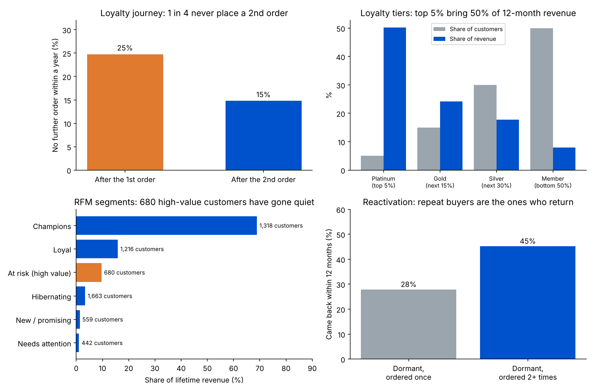

# Customer Retention, Loyalty and Reactivation Strategy

A retention and go-to-market analysis of a real online retailer's customer base: who stays, who drifts away, how a loyalty programme should be tiered, which dormant customers are worth winning back, and how an ML model can decide who gets a personalised offer.

**Data:** UCI Online Retail II, every transaction of a UK online giftware retailer from Dec 2009 to Dec 2011 (many of its customers are small wholesalers). After cleaning: **36,969 orders** from **5,878 customers**, **£17.7M** revenue.



## Key findings

| Area | Finding | Retention lever |
|---|---|---|
| The 2nd order | **25%** of new customers never place a 2nd order within a year; only **48%** do so within 90 days (median gap **55 days**). Once a customer has 2 orders, **85%** place a 3rd within a year. | Make the 2nd order the main loyalty goal: a welcome journey and a time-limited 2nd-order offer |
| Cohorts | About **23%** of each monthly cohort buys again in month 1, and the share stays at **22–25%** through month 12, so customers who stay, stay. | Spend early: the first months decide retention |
| Revenue concentration | In the last 12 months the top **20%** of customers brought **74%** of revenue and the bottom 50% only **8%**. | Tier the loyalty programme so rewards go where the revenue is |
| Loyalty tiers | Platinum (top 5%, **213** customers, £5.8K+ a year) bring **50%** of revenue and order about **22** times a year; Gold (next 15%) bring **24%**. | Service and early access for Platinum/Gold; points and nudges for Silver and Members |
| RFM segments | Champions are **22%** of customers and **69%** of lifetime revenue. **680** high-value customers are “at risk”: they averaged 5.4 orders but have not ordered for a median of **373 days** (**£1.7M** lifetime revenue). | Priority win-back list |
| Dormant base | **2,398** customers (**41%**) have not ordered for 180+ days. In the year before, dormant customers who had ordered 2+ times came back on their own at **45%**, against **28%** for one-time buyers. | Reactivate repeat buyers first; they respond best |
| Personalised offers | A gradient-boosting model, trained on one period and tested on the next, predicts who will order in the next 90 days with AUC **0.79** (a recency-only rule scores 0.76). Its top 20% buy at **82%** against a **43%** average. | Send offers by propensity: protect margin on likely buyers, spend discounts where they change behaviour |
| Reactivation case | Targeting the **1,246** dormant repeat buyers, **if** an offer wins back an extra 5% (assumption), that is about **62** customers and **£40.5K** in 12-month revenue for **£3.1K** of discount and contact cost. A holdout of about **736** customers per arm tests it. | Run as an A/B test before scaling |

## Method

**Cleaning.** Rows without a customer ID, cancellations (invoice starting with “C”), returns and zero-price lines are removed. Lines are summed to orders: order value = Σ (quantity × unit price).

**Cohort retention.** Customers are grouped by the month of their first order. Month-k retention = customers in the cohort who order in month k ÷ cohort size, averaged over cohorts old enough to have a month k.

**Second and third orders.** Only customers whose 1st order (or 2nd, for the 3rd-order rate) came at least 365 days before the end of the data are counted, so everyone had a full year to return.

**Loyalty tiers.** Customers active in the last 365 days are ranked by spend: Platinum = top 5%, Gold = next 15%, Silver = next 30%, Member = bottom 50%. Revenue share = tier revenue ÷ total 12-month revenue.

**RFM.** R = days since last order, F = number of orders, M = lifetime revenue, each scored 1–5 by quintile (5 = best). With FM = (F + M) ÷ 2: Champions R ≥ 4 and FM ≥ 4; Loyal R ≥ 3 and FM ≥ 3; New/promising R ≥ 4; At risk (high value) R ≤ 2 and FM ≥ 3; Needs attention R = 3; Hibernating the rest.

**Natural return rate.** At a cut-off one year before the end, take customers with no order for 180+ days; the rate is the share who ordered at least once in the following 12 months, with no campaign targeting them in the data.

**Propensity model.** `HistGradientBoostingClassifier` on recency, tenure, orders, revenue, average order value, items, orders and revenue in the last 90 and 365 days, average gap between orders and a UK flag. Trained on a cut-off 180 days before the end (label: ordered in the next 90 days) and tested on a cut-off 90 days before the end, so the test period is never seen in training. Capture at 20% = share of all buyers inside the top 20% of customers by score.

**Reactivation business case.** With N = target customers, r = incremental reactivation rate, S = average 12-month spend of a returning dormant customer (**£651**, measured), AOV = average order value (**£480**), d = discount on the first order back and k = cost per contact:

- Customers won = N × r
- Revenue = N × r × S
- Campaign cost = N × r × AOV × d + N × k

**Assumptions (not measured):** r = 5%, d = 10%, k = £0.10. Revenue is not profit; product margin is not in the data.

**Holdout size.** Per arm n = (z₁ + z₂)² × [p₀(1 − p₀) + p₁(1 − p₁)] ÷ (p₁ − p₀)², where z₁ = 1.96 (5% significance), z₂ = 0.84 (80% power), p₀ = the natural 90-day return rate (45% × 90/365 ≈ 11.2%, an approximation) and p₁ = p₀ + r.

## GTM plan for the retention programme

1. **Welcome journey (weeks 0–8):** email/WhatsApp after the 1st order, a 2nd-order offer that expires before day 55, the median return gap.
2. **Tiered loyalty:** Platinum and Gold get an account manager, early access and free delivery; Silver and Members earn points toward Gold.
3. **Win-back:** start with the 680 at-risk high-value customers, then other dormant repeat buyers; one-time buyers last.
4. **Personalisation:** the propensity score decides who gets a discount; likely buyers get a reminder instead.
5. **Measure:** a random holdout in every campaign; KPIs are 2nd-order rate within 90 days, reactivation rate against the holdout and revenue per contacted customer.

## SQL version

The core retention metrics are also written in SQL (`sql/retention_metrics.sql`, SQLite with CTEs and window functions): second-order rate within a year, third-order rate given two orders, loyalty-tier revenue share and the dormant base. `run_sql.py` loads the orders into SQLite, runs each query and checks it against the Python results; all five match.

## Limitations

- One retailer, 2009–2011, with many wholesale customers, so absolute rates are higher than for a typical consumer app.
- The data has no campaign history, so the campaign uplift is an assumption to be tested, not a result.
- Revenue is gross of returns that were removed and of product cost; it is not profit.
- The 90-day natural return rate spreads the 12-month rate evenly over the year.

## Run it

```bash
pip install pandas numpy scikit-learn matplotlib
python get_data.py       # only if data/ is empty: downloads the dataset and builds data/orders.csv.gz
python run_analysis.py   # writes results/results.json, cohort_retention.csv, customer_segments.csv
python make_charts.py    # writes results/summary.png
python run_sql.py        # runs the SQL queries and checks them against the Python results
```

## Data source

Chen, D. (2019), Online Retail II, UCI Machine Learning Repository (dataset 502). `data/orders.csv.gz` is the cleaned, order-level version the analysis reads; `get_data.py` rebuilds it from a public GitHub mirror of the original file.
